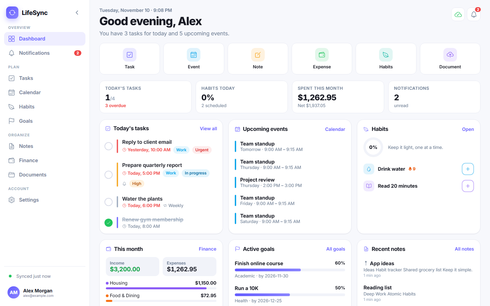
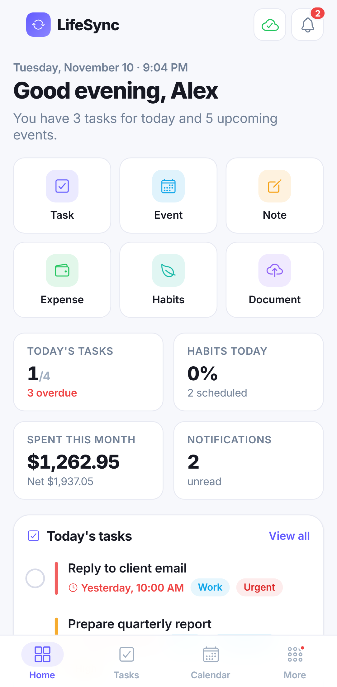
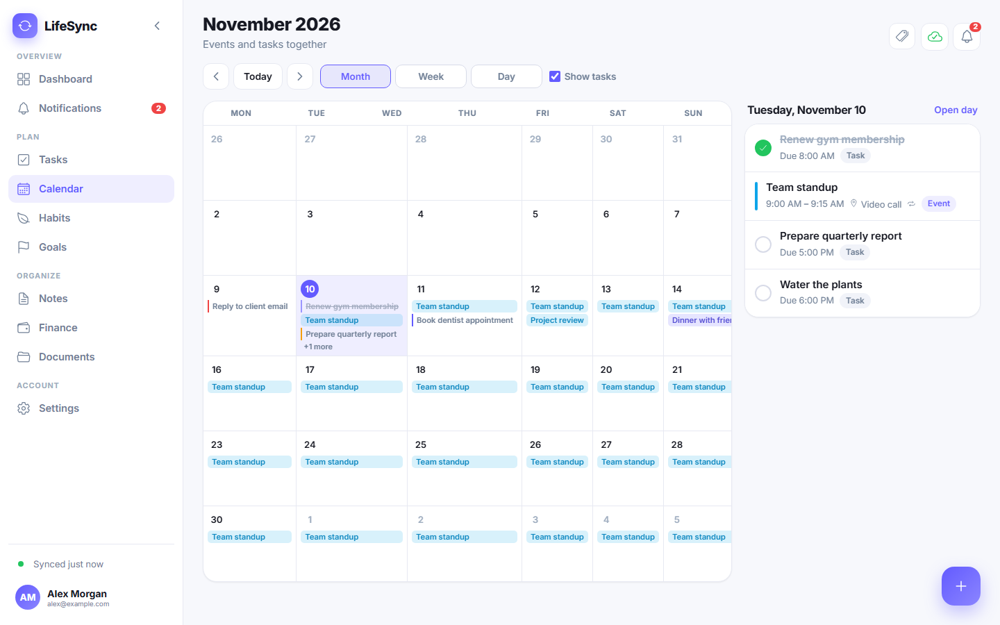
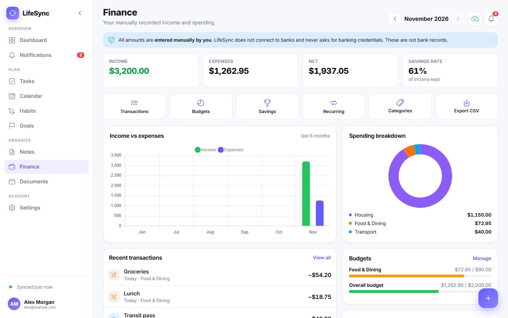
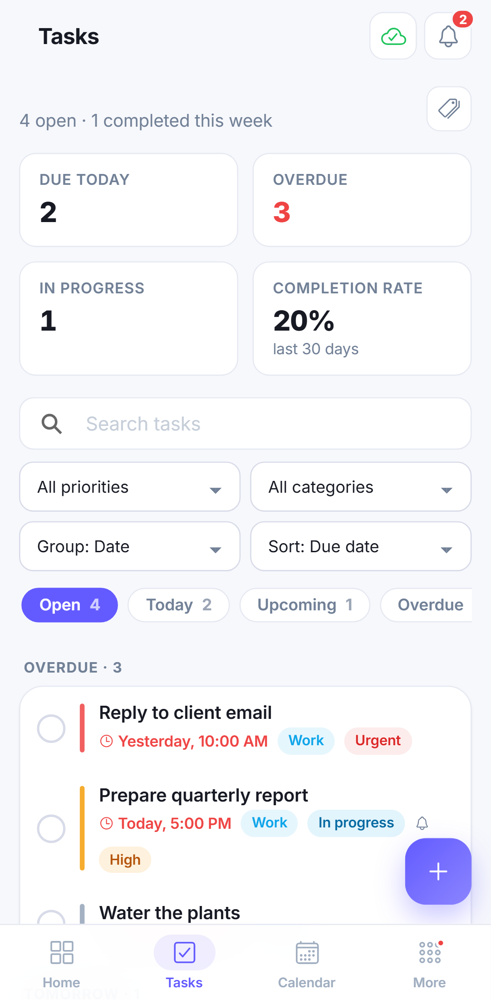
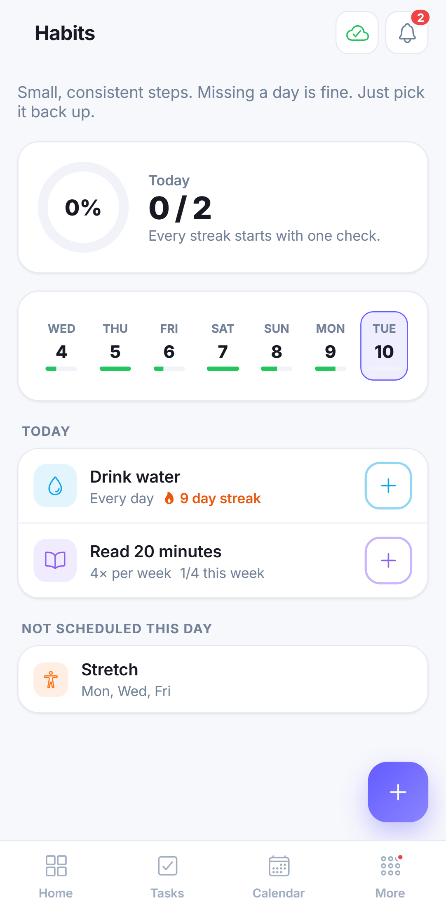
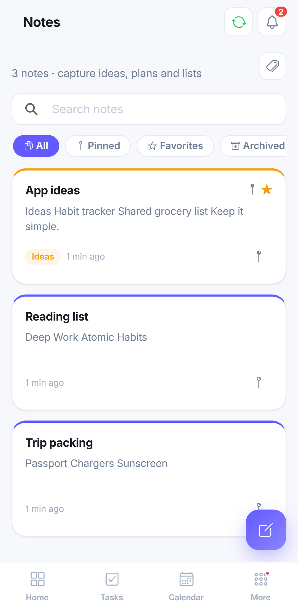
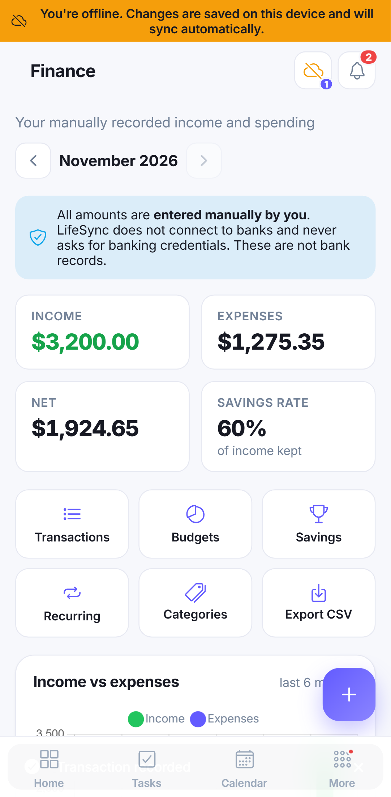
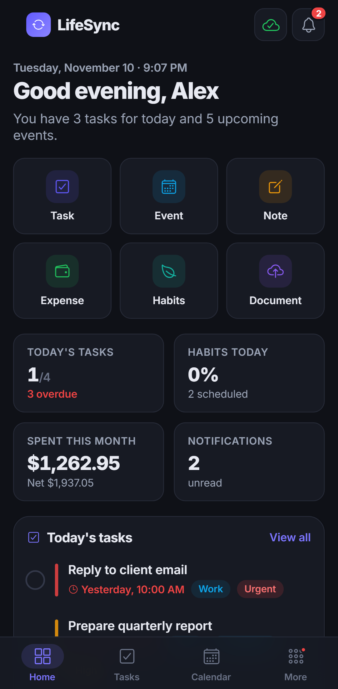

<div align="center">


# LifeSync

**Your whole life, beautifully in sync.**<br/>
Tasks, calendar, habits, notes, money, documents and goals in one private, offline-first app for Android, iOS, tablets and the web.

**Live app:** <https://lifesync-roan-nine.vercel.app> · **Android:** [download APK](https://github.com/shanmichaeldeguzman/LifeSync/releases/latest) · **API:** <https://lifesync-api-psi.vercel.app/api/health>

</div>

<p align="center">
  
  
</p>

## Features

| Module | Highlights |
| --- | --- |
| **Dashboard** | Personalized greeting, live date/time, today's tasks, upcoming events, habit progress, monthly spending, active goals, recent notes, upcoming reminders, quick actions. Widgets can be shown/hidden and reordered. |
| **Tasks** | Priorities (low → urgent), categories, statuses, due dates, reminders, recurring tasks (next occurrence created on completion), search, filters, sorting, grouping, completion stats. |
| **Calendar** | Month / week / day views, recurring events, categories, reminders, tasks and events together. |
| **Notes** | Markdown editor with toolbar and live preview, categories, pin, favorite, archive, search, autosave, last-modified times, private file attachments. |
| **Habits** | Daily, N-times-per-week or specific-day schedules, check-ins (also for past days), streaks, calendar heatmap, weekly/monthly stats, charts, gentle reminders. |
| **Finance** | Income & expenses, custom categories, payment methods, monthly budgets per category or overall (alerts at 80 % / 100 %), savings goals, recurring transactions, charts, filters, CSV export. **Manually recorded only: never connects to banks.** |
| **Documents** | Upload PDFs/images (or scan with the camera on Android), categories, search, in-app preview, expiration dates with reminders, download, delete. Private storage, no public links. |
| **Goals** | Academic / personal / professional / financial / health goals, target dates, milestones or manual progress, completion history, reminders. |
| **Notifications** | Central inbox for task, event, habit, budget, document and goal alerts; read/unread, filters, history; device notifications. |
| **Settings** | Profile & photo, email & password, light/dark/system theme, notification preferences, dashboard layout, hide amounts, data export (JSON), account deletion, sync status. |

**Offline-first:** everything works without a connection. Changes are stored on the device, marked **Local**, and synced automatically when you're back online. Edits made on two devices are never silently overwritten; you choose which version to keep.

<p align="center">
  
  
</p>
<p align="center">
  
  
  
  
  
</p>

## Tech stack

| Layer | Technology |
| --- | --- |
| Mobile & web app | Ionic 9, Angular 22 (standalone, signals, zoneless), TypeScript, SCSS, Capacitor 8 (Android), Chart.js, Dexie (IndexedDB), marked + DOMPurify, Angular service worker (PWA) |
| Native features | Capacitor Local Notifications, Camera, Filesystem, Share, Network, Status Bar |
| API | Node.js, Express 5, zod validation, helmet, CORS allow-list, express-rate-limit, pino logging |
| Data | Supabase PostgreSQL with Row Level Security, Supabase Auth (email/password, verification, reset), Supabase Storage (private buckets), pg_cron |
| Testing | Vitest + Supertest (API), PGlite (real migrations + RLS), Angular unit tests, Playwright (phone, tablet, desktop) |
| Hosting (free) | Vercel (web + API), Supabase (DB/auth/storage), GitHub |

Architecture, data model and security details: **[docs/ARCHITECTURE.md](docs/ARCHITECTURE.md)** · **[docs/DATABASE.md](docs/DATABASE.md)** · **[docs/API.md](docs/API.md)**

## Repository layout

```
LifeSync/
├── frontend/            Ionic + Angular app (web, PWA, Android via Capacitor)
│   ├── src/app/core     data layer (IndexedDB, sync), services, guards, interceptors, utils
│   ├── src/app/features feature pages: dashboard, tasks, calendar, notes, habits, finance, …
│   ├── src/app/shared   reusable components (charts, pickers, empty states, …)
│   ├── e2e/             Playwright tests (mock backend)
│   └── android/         Capacitor Android project
├── backend/             Express REST API (routes → controllers → services), tests, Vercel entry
├── supabase/            config, SQL migrations, development seed
├── docs/                architecture, API, database, deployment, testing, screenshots
└── render.yaml          optional Render blueprint for the API
```

## Getting started (local development)

### Prerequisites

- Node.js 20+ (tested with 26) and npm
- A Supabase project (free) **or** the Supabase CLI with Docker for a local stack
- For Android builds: Android SDK 36 and JDK 17/21

### 1. Database

```bash
# Hosted Supabase project
npx supabase login
npx supabase link --project-ref <your-project-ref>
npx supabase db push

# …or fully local (Docker): migrations + demo data (demo@lifesync.local / LifeSync123)
npx supabase start && npx supabase db reset
```

In **Authentication → URL Configuration** add `http://localhost:8100/**` as a redirect URL.

### 2. API

```bash
cd backend
cp .env.example .env      # fill SUPABASE_URL, SUPABASE_ANON_KEY, SUPABASE_SERVICE_ROLE_KEY
npm install
npm run dev               # http://localhost:3000/api/health
```

### 3. App

```bash
cd frontend
cp .env.example .env      # LIFESYNC_SUPABASE_URL, LIFESYNC_SUPABASE_ANON_KEY, LIFESYNC_API_URL
npm install
npm start                 # http://localhost:4200
```

### 4. Android

```bash
cd frontend
npm run build:android                       # web build + cap sync
cd android && ./gradlew assembleDebug       # → app/build/outputs/apk/debug/app-debug.apk
```

## Environment variables

**Backend** (`backend/.env`, or the hosting provider's settings)

| Variable | Required | Description |
| --- | --- | --- |
| `SUPABASE_URL` | yes | `https://<ref>.supabase.co` |
| `SUPABASE_ANON_KEY` | yes | Public anon/publishable key (used with each user's JWT, so RLS applies) |
| `SUPABASE_SERVICE_ROLE_KEY` | for account deletion | **Secret.** Server only. Used exclusively to delete accounts. |
| `CORS_ORIGINS` | yes (prod) | Comma-separated allowed origins, e.g. `https://lifesync.vercel.app,https://localhost,capacitor://localhost` |
| `PORT`, `NODE_ENV`, `LOG_LEVEL` | no | Defaults: `3000`, `development`, `info` |

**Frontend** (`frontend/.env` or build-time env; baked in by `scripts/set-env.mjs`)

| Variable | Description |
| --- | --- |
| `LIFESYNC_SUPABASE_URL` | Supabase project URL |
| `LIFESYNC_SUPABASE_ANON_KEY` | Public anon key (safe for browsers) |
| `LIFESYNC_API_URL` | API base URL ending in `/api` |
| `LIFESYNC_APP_URL` | Public URL of the web app (email redirect links) |

The build refuses to run if a service-role key is supplied to the frontend. `.env` files are git-ignored.

## Testing

```bash
cd backend  && npm test          # 53 tests: API (Supertest) + schema/RLS/triggers on real migrations (PGlite)
cd frontend && npm test          # unit tests: streaks, recurrence, sync payloads, sanitizer, CSV
cd frontend && npx playwright test   # 21 e2e tests on phone, tablet and desktop viewports
```

Against production: `backend/scripts/isolation-check.mjs` (61 API/RLS/storage checks) and
`npx playwright test -c playwright.live.config.ts` (14 real-browser tests on desktop + phone).

See **[docs/TESTING.md](docs/TESTING.md)** for what each suite covers and the latest results. After deploying, `backend/scripts/isolation-check.mjs` verifies the live system end-to-end, including cross-account isolation.

## Deployment

The live deployment runs on **Supabase Free** (Singapore region: Postgres, Auth, Storage, pg_cron) and **Vercel Hobby** (web app + API).

Free-tier setup (Supabase + Vercel + GitHub), step by step: **[docs/DEPLOYMENT.md](docs/DEPLOYMENT.md)**, including free-tier limitations and the post-deployment checklist.

## Security & privacy

- Row Level Security on every table; the API also queries as the signed-in user.
- Private storage buckets restricted to each user's folder; only short-lived URLs.
- Input validation on client, API (zod) and database (constraints); sanitized Markdown; formula-safe CSV.
- Helmet headers, CORS allow-list, rate limiting, no tokens or bodies in logs.
- No bank connections; financial records are explicitly labelled as manual entries.
- Data export and permanent account deletion (password re-check) built in. Local data is wiped from the device on sign-out.
