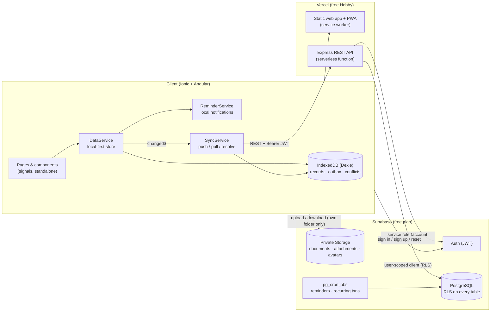
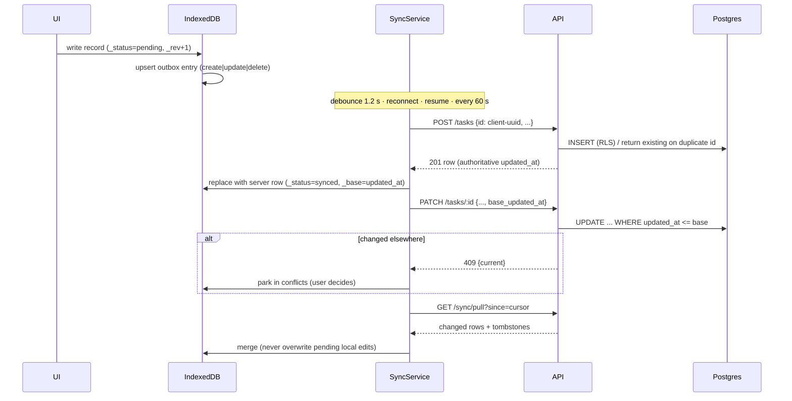

# LifeSync Architecture

## System overview



### Why this shape

| Decision | Reason |
| --- | --- |
| **Supabase Auth, Postgres, Storage** | One free platform covers authentication, a real relational database and private file storage. Row Level Security (RLS) enforces data isolation *in the database*, so even a bug in the API cannot leak another user's rows. |
| **Express REST API** | Validation (zod), consistent error envelopes, pagination/search, optimistic concurrency, CSV/data export and account deletion live in one auditable place. The API forwards the caller's JWT to Postgres, so RLS still applies to every query. The service-role key is used only for deleting an account. |
| **Direct-to-Storage uploads** | Files go straight from the device to the user's private folder (`<user_id>/...`). Bucket policies, size limits and MIME allow-lists are enforced server-side by Supabase; the API then validates the path and records metadata. This avoids serverless body-size limits. |
| **Local-first client** | Every read comes from IndexedDB and every write lands there first, so the app is fully usable offline. A coalescing outbox replays changes when connectivity returns. |
| **Vercel for web + API** | Free, HTTPS by default, no cold-start sleep like some free container hosts. A `render.yaml` blueprint is included as an alternative API host. |

## Frontend structure

```
frontend/src/app
├── core/
│   ├── data/            # LocalDatabase (Dexie), DataService, SyncService
│   ├── guards/          # authGuard, guestGuard
│   ├── interceptors/    # authInterceptor (Bearer token + one silent refresh)
│   ├── models/          # shared interfaces mirroring the DB schema
│   ├── services/        # auth, api, supabase, storage, network, theme, reminders, session, ui
│   └── utils/           # dates, recurrence, habit streaks, markdown, formatting, files
├── layout/              # ShellComponent: sidebar (desktop) / bottom nav (mobile)
├── shared/components/   # empty state, skeleton, charts, pickers, sync badge, category manager…
└── features/            # auth, dashboard, tasks, calendar, notes, habits, finance,
                         # documents, goals, notifications, settings, more
```

## Offline sync protocol



Key properties:

- **No duplicates:** records get client-generated UUIDs; a replayed `POST` returns the existing row.
- **No silent data loss:** conflicting edits, edits to records deleted elsewhere, and rejected changes are shown on *Settings → Sync*, where the user keeps their version, takes the other one, or (for notes) keeps both.
- **Survives restarts:** the outbox and local records live in IndexedDB.
- **Clear status:** items saved only on the device show a **Local** badge; the header shows sync and online/offline state.
- **Online-only operations:** file uploads, profile/password/email changes, data export and account deletion need a connection (the UI says so).

## Notifications

| Layer | What it does |
| --- | --- |
| Database (`generate_notifications_for`, `transactions_check_budgets`) | Creates Notification Center entries for task reminders, upcoming events, habits, document expiry, goal deadlines and budget thresholds (80 % / 100 %). Idempotent via `dedupe_key`. Runs on app sync and every 10 min via `pg_cron`. |
| Android / iOS (Capacitor Local Notifications) | Schedules OS notifications for the next 7 days; delivered even when the app is closed. |
| Web / PWA | Browser notifications and in-app toasts while the app is open. Closed-browser push would need a push service (e.g. FCM) and is intentionally not promised. |

## Security model

- Supabase JWTs verified by the API (`auth.getClaims`, JWKS); per-request DB client carries the user's token, so **RLS applies to every query**.
- RLS policies on every table (`user_id = auth.uid()`), plus triggers preventing links to other users' parent rows.
- Private storage buckets; objects restricted to `<auth.uid()>/…`; only short-lived blob/signed URLs, never public links.
- Helmet security headers, strict CORS allow-list, rate limiting (global + strict on account deletion), 1 MB JSON limit.
- Logs never include Authorization headers or request bodies.
- Markdown rendered through DOMPurify; CSV exports neutralise spreadsheet formulas.
- Local cached data is deleted from the device on sign-out.
