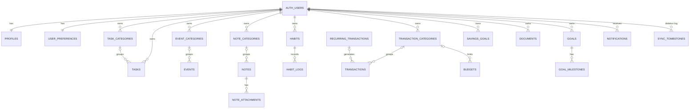

# LifeSync Database

PostgreSQL on Supabase. Migrations live in [`supabase/migrations`](../supabase/migrations):

| Migration | Contents |
| --- | --- |
| `20261110000001_core_schema.sql` | Tables, constraints, indexes, `updated_at` + tombstone triggers, recurring-task and goal/milestone triggers, new-user bootstrap (profile, preferences, starter categories). |
| `20261110000002_security_and_automation.sql` | Row Level Security, FK ownership checks, private storage buckets and policies, budget alerts, notification engine, recurring transactions, data export, function privileges, `pg_cron` schedules. |

`supabase/seed.sql` adds a demo account and sample data for **local development only**.

## Entity relationships



`auth.users` is Supabase's managed users table. All personal tables reference it with `ON DELETE CASCADE`, so deleting an account removes every row.

## Tables

| Table | Purpose | Notable constraints |
| --- | --- | --- |
| `profiles` | Name, avatar path, timezone, currency | 1:1 with user; `currency ~ '^[A-Z]{3}$'` |
| `user_preferences` | Theme, notification toggles, dashboard widgets, privacy | 1:1 with user |
| `task_categories`, `event_categories`, `note_categories` | Per-module categories | unique `(user_id, name)`, hex color check |
| `transaction_categories` | Income/expense categories | unique `(user_id, type, name)` |
| `tasks` | Title, description, priority, status, due/reminder, recurrence | enums via CHECK; recurring tasks require a due date |
| `events` | Calendar events with recurrence and reminders | `end_at >= start_at` |
| `notes` | Markdown notes; pinned / favorite / archived | 100 k character limit |
| `note_attachments` | Files attached to notes (private `attachments` bucket) | ≤ 10 MB |
| `habits` | Daily / N-per-week / specific-days habits | custom schedule requires days |
| `habit_logs` | One check-in per habit per day | unique `(habit_id, log_date)` |
| `transactions` | Manually recorded income/expenses | `amount > 0`; `entry_source in ('manual','recurring_rule')` |
| `recurring_transactions` | Rules that generate transactions | idempotent generation via unique `(recurring_transaction_id, transaction_date)` |
| `budgets` | Monthly limit, overall (`category_id` null) or per category | unique **nulls not distinct** `(user_id, month, category_id)`; month is the 1st |
| `savings_goals` | Target and saved amounts | non-negative amounts |
| `documents` | Metadata for files in the private `documents` bucket | PDF/JPEG/PNG/WebP, ≤ 10 MB, unique storage path |
| `goals` | Goals with category, target date, status, manual or milestone progress | progress 0–100 |
| `goal_milestones` | Ordered steps toward a goal | |
| `notifications` | Notification Center entries | unique `(user_id, dedupe_key)` |
| `sync_tombstones` | Deleted record ids for offline clients | cleaned when the account is deleted |

Every table has `created_at` / `updated_at` (`updated_at` is set by trigger, so the server clock is authoritative for sync) and indexes on `(user_id, updated_at)` for incremental sync, plus query-specific indexes (due dates, transaction dates, event starts…).

## Row Level Security

- Enabled **and forced** on every personal table.
- Policies: `select/insert/update/delete ... to authenticated using (user_id = auth.uid()) with check (user_id = auth.uid())`.
- `profiles` and `user_preferences`: select/update own row only (rows are created by the `handle_new_user` trigger).
- `anon` has no table privileges at all.
- `assert_same_owner` triggers stop a user from referencing another user's parent row (FK checks bypass RLS).
- Storage: buckets `documents`, `attachments`, `avatars` are **private**; object policies require the first path segment to equal `auth.uid()`.

## Server-side automation

| Function | Trigger / caller | Behavior |
| --- | --- | --- |
| `tasks_before_write`, `tasks_spawn_next_occurrence` | task insert/update | Maintains `completed_at`; completing a recurring task once creates the next occurrence atomically. |
| `transactions_check_budgets` | expense insert/update | Inserts budget notifications at 80 % and 100 % (once per budget per threshold). |
| `generate_notifications_for(uid)` | `refresh_my_notifications()` RPC, `pg_cron` every 10 min | Task reminders/due soon, event reminders (recurrence-aware), habit check-ins (user timezone), document expiry, goal deadlines/reminders; respects preferences. |
| `run_recurring_transactions_for(uid)` | `run_my_recurring_transactions()` RPC, `pg_cron` hourly | Materialises due occurrences atomically and idempotently. |
| `export_my_data()` | API `GET /api/account/export` | JSON export of all of the caller's data (runs under RLS). |

Scheduler-only functions have `EXECUTE` revoked from `public`, `anon` and `authenticated`.

## Applying migrations

```bash
# Hosted project (from the repo root)
npx supabase login                      # or set SUPABASE_ACCESS_TOKEN
npx supabase link --project-ref <ref>
npx supabase db push                    # applies supabase/migrations

# Local development (requires Docker)
npx supabase start
npx supabase db reset                   # migrations + seed.sql
```

## Tests

`backend/tests/db` runs the real migrations on PGlite (in-process Postgres) with stand-ins for Supabase's `auth`/`storage` schemas and verifies isolation between accounts, triggers, constraints, notification idempotency, recurring logic, storage policies, account deletion and the seed script:

```bash
cd backend && npm run test:db
```
